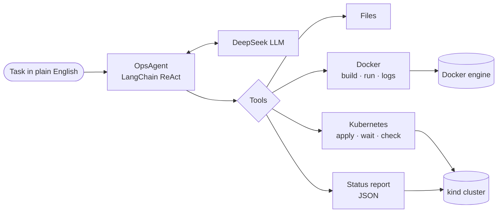

# Lab 3 – Operations Agent with LangChain and ReAct


**Advanced Software Engineering · Wuhan University**
Sana Hameed (2026272110001) · Instructor: Jian Wang

An AI agent that does an operator's job. You give it a task in plain English; it decides the steps itself, calls tools for files, Docker and Kubernetes, checks the result and reports back.

---

## What the agent did

| Task | Run | Result |
| --- | --- | --- |
| Read a project's README, write a Dockerfile, build the image and run the container (lab guide task) | Run 3b · 24.7 min · 19 tool calls | ✅ App served on `localhost:8080` (HTTP 200) |
| Deploy the same image to Kubernetes: namespace, Deployment, Service, wait for ready, verify (my extension) | Run K1c · 12.7 min · 7 tool calls | ✅ 2/2 pods ready, 2 ready endpoints, HTTP 200 |
| Answer status questions in a chat, remembering earlier questions | Chat demo | ✅ Structured JSON status report, "its" understood from memory |

The application deployed is the open-source [Vue Paper Dashboard](https://github.com/creativetimofficial/vue-paper-dashboard).

## How it works

The agent follows the **ReAct** pattern: the LLM writes a *Thought*, chooses an *Action* (one tool), reads the *Observation* (the tool's result) and repeats until it can give a *Final Answer*.



Around the LLM there are four safety nets, all written in code rather than only in the prompt:

- **Output parser** – understands DeepSeek's own tool-call format (DSML), bare JSON and plain answers.
- **Verification tools** – container logs and a service check that counts ready endpoints, so "running" is not mistaken for "working".
- **Guards** – Kubernetes changes only in `lab3-*` namespaces, only Deployment / Service / ConfigMap, dry run before every apply, no delete tool, node containers blocked.
- **LoopGuard** – stops the agent from calling the same tool with the same input twice in a row.

## Problems found and fixed

| Problem seen in a run | Fix | Test |
| --- | --- | --- |
| Container running but app broken (Run 2) | `container_logs_tool` + rule "check logs after starting" | – |
| DeepSeek answered in DSML, taken as the final answer (Run 3a) | `RobustStructuredChatOutputParser` | TC1–TC4 |
| DSML value `"true"` crashed a tool (K1a) | Decode action input as JSON | TC12 |
| Agent ran commands inside Kubernetes node containers (K1b) | Node and registry containers blocked | TC13–TC14 |
| Service check said OK without ready pods (K1b) | Count ready endpoints + HTTP 200 | – |
| Same tool called 10 times in a row (chat demo) | `LoopGuard` circuit breaker | TC21–TC23 |

## Project structure

```
main.py                  guide task: Dockerfile → image → container
main_k8s.py              Kubernetes deployment task
chat_agent.py            chat with memory and structured output
llm_smoke_test.py        checks the LLM connection
core/
  agent_builder.py       OpsAgent (LangChain AgentExecutor)
  helper/                LLM setup, logger, output parser, loop guard, structured output
  prompts/               system prompt, Dockerfile / diagnosis / manifest prompts
  tools/                 file, Docker, diagnosis, Kubernetes and status tools
tests/                   23 test cases
k8s/                     manifest written by the agent
vue-paper-dashboard/     the deployed app + the Dockerfile written by the agent
lab2_tools/              scripts and data of the Lab 2 re-runs
output/logs/             trace logs of every agent run
```

## Run it yourself

**Requirements:** Windows, Docker Desktop with Kubernetes, Python 3.11, [uv](https://docs.astral.sh/uv/), an OpenAI-compatible API key.

```powershell
uv sync
```

Create `.env` (not included in this repository):

```
OPENAI_API_KEY=<your key>
OPENAI_BASE_URL=https://api.deepseek.com
MODEL_NAME=deepseek-flash
SERPER_API_KEY=<optional>
```

```powershell
uv run llm_smoke_test.py         # check the LLM connection
uv run main.py                   # Docker task
uv run main_k8s.py               # Kubernetes task
uv run chat_agent.py --demo      # chat demo
```

If Docker Hub is blocked on your network, set a proxy in Docker Desktop and run `$env:DOCKER_BUILDKIT = "0"` first.

## Tests

No LLM or cluster needed:

```powershell
uv run python tests/test_output_parser.py      # 7 tests
uv run python tests/test_k8s_guards.py         # 9 tests
uv run python tests/test_structured_output.py  # 4 tests
uv run python tests/test_loop_guard.py         # 3 tests
```

## Notes

- LangChain 1.x moved `initialize_agent` and `AgentType` to `langchain-classic`; they are imported from there.
- `vue-paper-dashboard/` is by Creative Tim (MIT licence, see its `LICENSE.md`). Only its `Dockerfile` was written by the agent.
- `lab2_tools/bookinfo_monitor_v2.py` was re-implemented on 31 Oct 2026; the original Lab 2 script was not found.
- No API keys are stored in this repository.
